<h1 align="center">Quorum</h1>

<p align="center"><b>A software update installs only if a quorum of independent witnesses has seen the exact same file.</b><br>
The update server stops being a party you have to trust.</p>

<p align="center">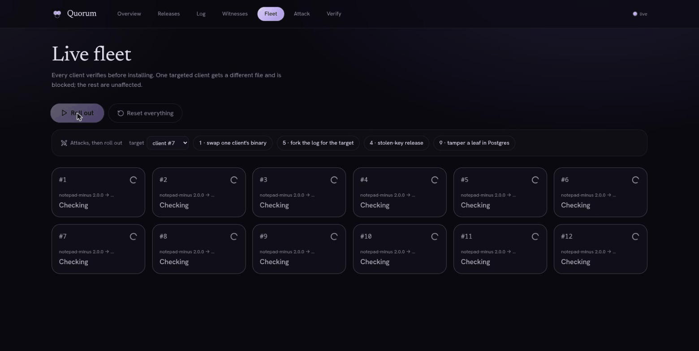</p>

<p align="center"><sub>The whole demo, recorded from the running stack: a clean rollout, attack 1 (one client gets a different binary), attack 5 (the log forks one client's view), attack 4 (a stolen-key release), then all ten scenarios.</sub></p>

---

## The problem

Update channels are being hijacked, and code signing did not save the victims.

| Incident | What happened | What would have exposed it |
|---|---|---|
| **Notepad++** (June 2025, disclosed Feb 2026) | Updater traffic hijacked through the hosting provider; only a subset of users received malicious installers | Different clients were offered different files for one version |
| **eScan** (20 Jan 2026) | A regional update server pushed a malicious replacement for about two hours | A release that is not in the public log |
| **AOMEI Backupper** (May to July 2026) | Update files tampered for **5 to 10 minutes at a time**; the app did not verify them | A different hash for the same version, seen by the witnesses |
| **cPGuard** (2 Nov 2026) | Fake versions uploaded with a **stolen publishing key** to about 2,950 servers, running as root | A signed release the vendor never approved: it is public the moment it is logged |

Several were **selective**: only chosen targets got the bad file, so researchers reproducing the issue saw nothing. Nobody can catch an update that only the victim sees. Quorum makes that visible.

## How it works

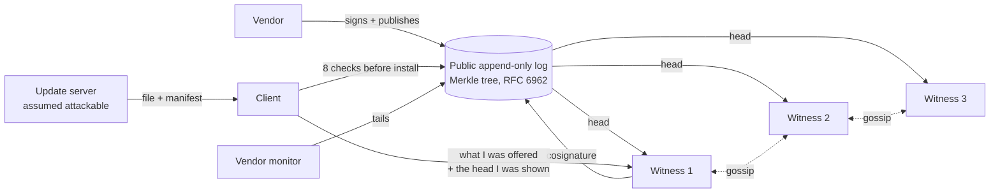

1. **Publish.** The vendor signs a release entry and appends it to the log. The log signs a new head.
2. **Witness.** Each witness checks the new head is a consistent extension of the last one it cosigned, then cosigns it. Witnesses gossip heads to each other.
3. **Verify, before install.** The client checks: file hash, vendor signature, right app and platform (and not a downgrade), inclusion proof, log signature, at least k of n fresh witness cosignatures, no open alert. Any error, including an unreachable log or witness, blocks the install: it **fails closed**.
4. **Report.** Clients report what they were offered and forward the head they were shown. Two hashes for one version, or two signed heads for one tree size, raise an alert. One victim's view becomes evidence for everyone.
5. **Monitor.** A vendor monitor tails the log and flags any release that is not on the approved list. This is what turns a stolen key into a loud failure.

## Screenshots

<table>
<tr>
<td width="50%">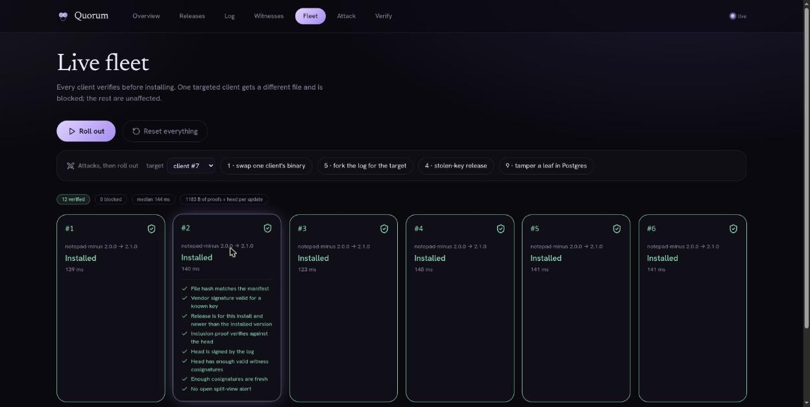<br><sub><b>Fleet.</b> Twelve clients each run eight checks before installing. Click a tile to see them.</sub></td>
<td width="50%">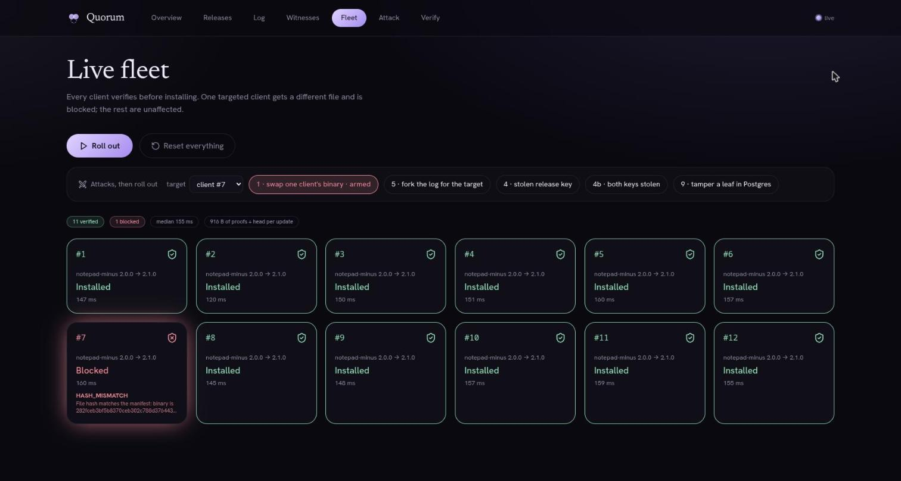<br><sub><b>Attack 1.</b> The update server swaps one client's binary. Client 7 is blocked; the other eleven are unaffected.</sub></td>
</tr>
<tr>
<td>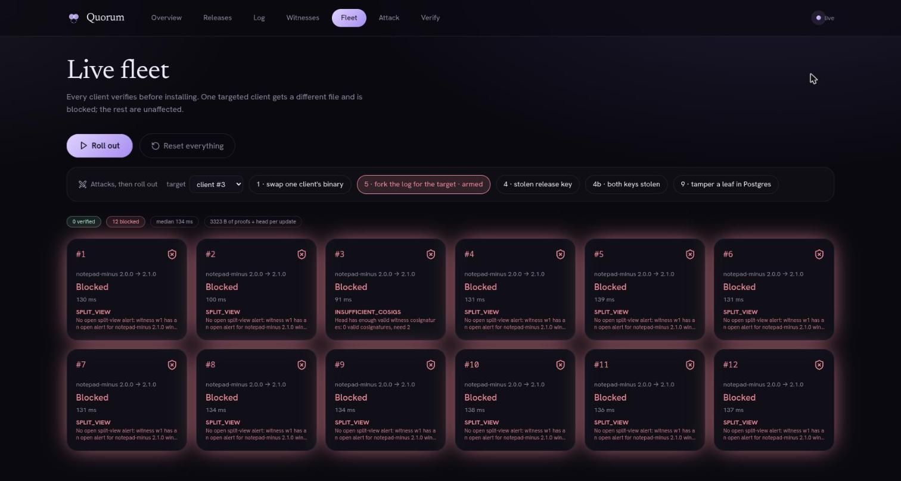<br><sub><b>Attack 5.</b> The log operator forks one client's view. Client 3 has no witness cosignatures, and the head it forwards proves the fork, so every client fails closed.</sub></td>
<td>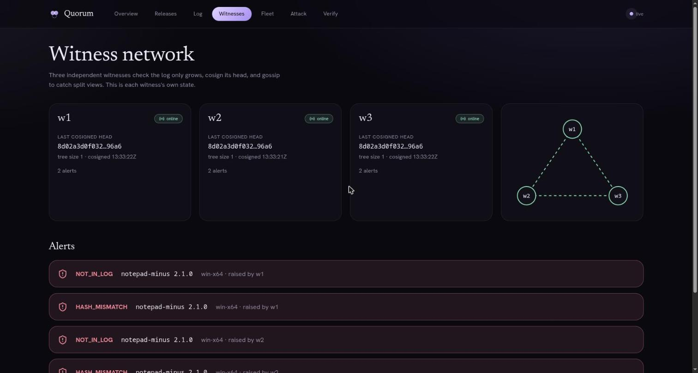<br><sub><b>Witnesses.</b> Each witness's own state: last cosigned head, alerts, evidence.</sub></td>
</tr>
<tr>
<td>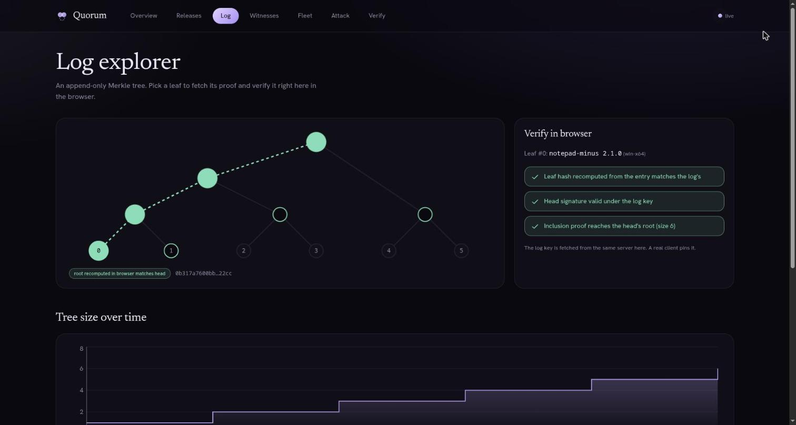<br><sub><b>Log explorer.</b> Pick a leaf; its inclusion proof is recomputed and verified in your browser, not on our server.</sub></td>
<td>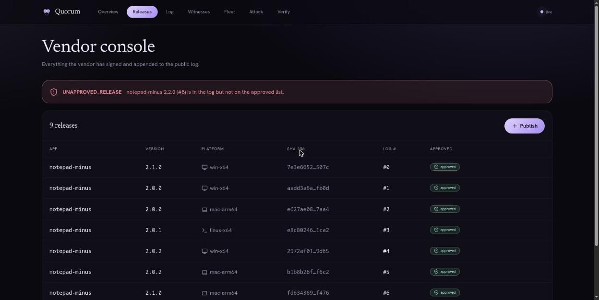<br><sub><b>Attack 4.</b> A stolen key logs a malicious release. Clients accept it, but the vendor monitor flags it within a poll: you cannot do it quietly.</sub></td>
</tr>
<tr>
<td>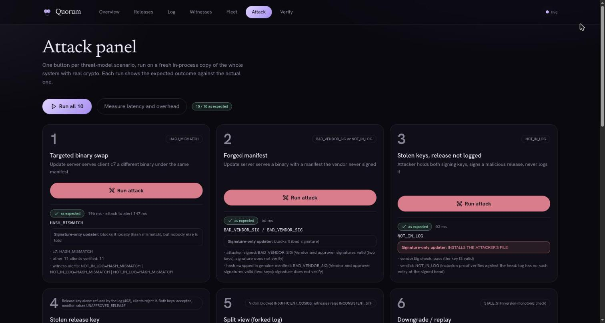<br><sub><b>Attack panel.</b> All ten threat-model scenarios, run for real, each beside what a signature-only updater does.</sub></td>
<td>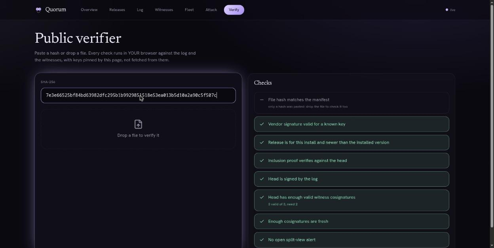<br><sub><b>Public verifier.</b> Paste a hash or drop a file; every check runs in your browser with keys pinned by the page.</sub></td>
</tr>
</table>

<details>
<summary>More: overview, vendor console, log, scenario detail</summary>

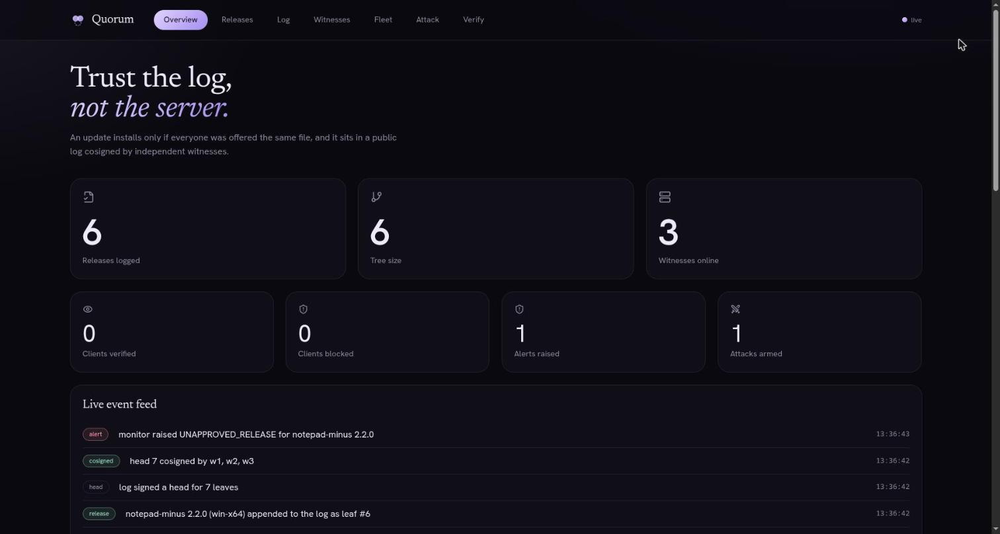
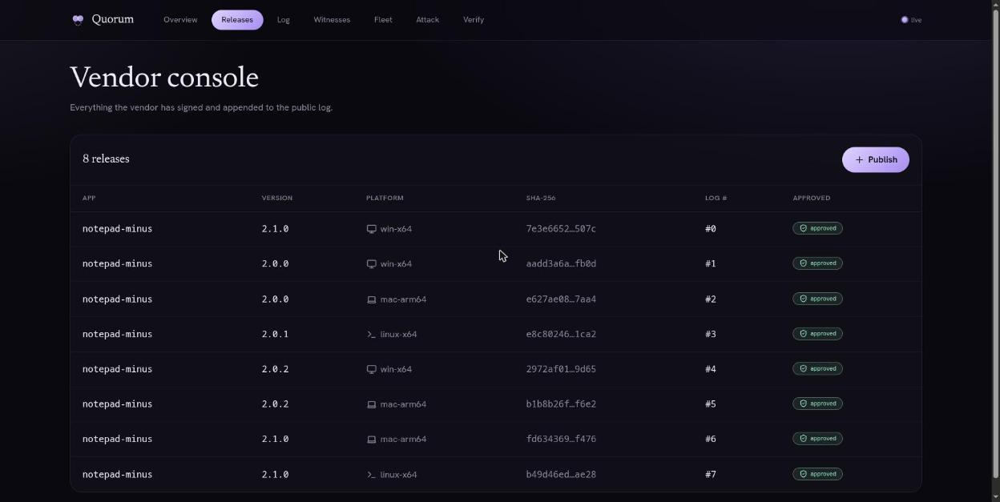
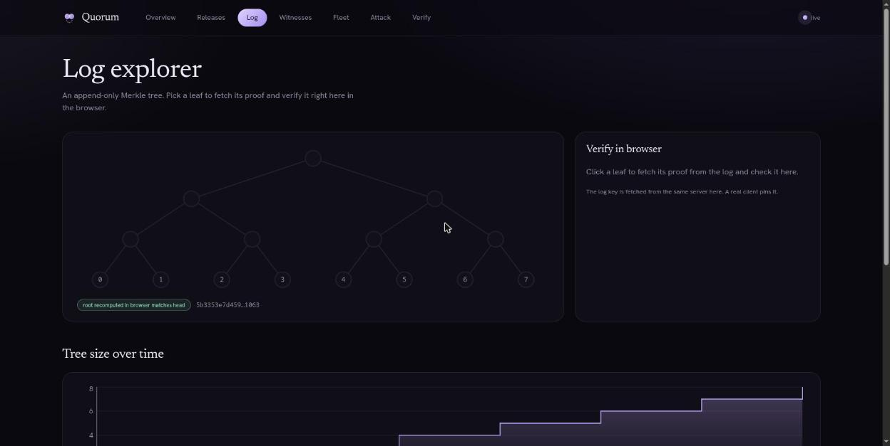
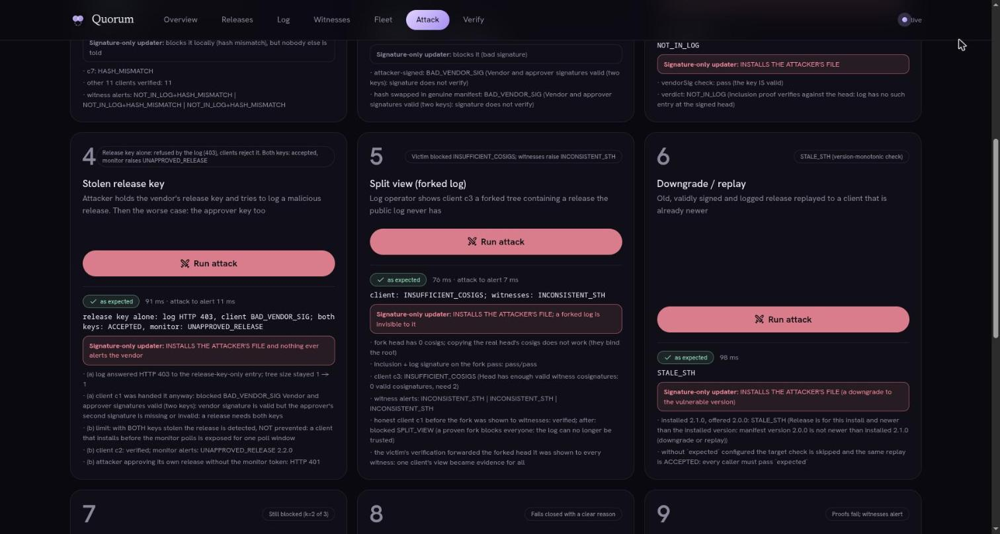

</details>

## Run it

```bash
npx -y pnpm@10 env:init          # fresh keys into a gitignored .env (refuses to overwrite)
docker compose up --build        # builds one image, starts Postgres, the log, 3 witnesses, the monitor, the update server, the demo server and the dashboard
```

A one-shot `seed` container publishes `notepad-minus 2.1.0` and waits until two witnesses have cosigned it. Then open **http://localhost:3000**:

| Page | What it shows |
|---|---|
| **Overview** | Live counters and an event feed, streamed from the real services |
| **Releases** | Vendor console: published releases, approval status, `UNAPPROVED_RELEASE` alerts |
| **Log** | Merkle tree, tree growth over time, signed heads with per-witness cosignature badges, in-browser proof verification |
| **Witnesses** | Each witness's status, last cosigned head, gossip, alerts with evidence |
| **Fleet** | Twelve clients verifying and installing; arm attacks 1, 5, 4 or 9 against the live stack and roll out |
| **Attack** | All ten scenarios, plus latency and overhead |
| **Verify** | Public verifier running every check in your browser |

`docker compose down -v` gives a pristine stack. To present it: [`submission/deck/index.html`](submission/deck/index.html) is a self-contained slide deck (open it in a browser; arrow keys to move, **N** for speaker notes, **F** for fullscreen), [`submission/SCRIPT.md`](submission/SCRIPT.md) is the spoken script, and [`submission/RUNBOOK.md`](submission/RUNBOOK.md) walks through the live demo step by step and explains what each step does underneath. Pitch text and sources are in [`submission/PITCH.md`](submission/PITCH.md).

Without Docker (public dev keys, in-memory log, **demos only**), tests, and the smoke test:

```bash
npx -y pnpm@10 install
npx -y pnpm@10 -r --if-present test                              # unit, integration and the ten attack scenarios
TEST_DATABASE_URL=postgresql://uw:uw@localhost:5432/uw npx -y pnpm@10 -r --if-present test   # plus the real-Postgres tests
npx -y pnpm@10 --filter @uw/demo smoke                           # drives every live attack against a running stack
```

## Adopt it in an app

You keep your update server and installer and add one gate. See [`examples/guarded-updater`](examples/guarded-updater).

```bash
uw keygen                                   # vendor key; register the public half with the log
VENDOR_SECRET_KEY=... uw publish ./app.exe --app notepad-minus --version 2.1.0 \
  --platform win-x64 --url https://cdn.example/app.exe --key-id release-2026 --log https://log.example
```

```ts
const cfg = parseTrust(trustBundle, { expected: { app, platform, installedVersion } });  // bundle baked into the app, never fetched from the log
const verdict = await verifyUpdate(bytes, manifest, cfg);                               // never throws, fails closed
if (!verdict.ok) abort(verdict.reason, verdict.detail);
install(bytes);
```

The same gate fits any auto-updating tool that runs with local privileges, including AI agent runtimes and MCP servers.

## The ten scenarios

`/attack` and `pnpm --filter @uw/demo test` run the same module on a fresh in-process copy of the system (real services, real crypto). Each scenario also shows what a **signature-only updater** (hash plus vendor signature) does with the same attack.

| # | Attack | Signature-only updater | Quorum |
|---|---|---|---|
| 1 | Update server swaps one client's binary | blocks locally, nobody told | `HASH_MISMATCH`; the other 11 clients are unaffected; every witness alerts |
| 2 | Forged manifest | blocks | `BAD_VENDOR_SIG` |
| 3 | Stolen key, release not logged | **installs** | `NOT_IN_LOG` |
| 4 | Stolen key, release logged | **installs**, vendor never learns | accepted; monitor raises `UNAPPROVED_RELEASE` |
| 5 | Log operator forks the tree | **installs** | victim blocked `INSUFFICIENT_COSIGS`; its forwarded head makes every witness raise `INCONSISTENT_STH` |
| 6 | Downgrade replay | **installs** | `STALE_STH` (when the caller passes `expected`) |
| 7 | One witness compromised | **installs** | still blocked at k=2 (at k=1 it would not be) |
| 8 | Log or witnesses down, witnesses silent | n/a | fails closed with a reason |
| 9 | Stored leaf tampered in Postgres | n/a | log refuses or proofs fail; witnesses and monitor alert |
| 10 | Two clients told different hashes | blocks locally | `HASH_MISMATCH` |

## What is in the repo

| Path | |
|---|---|
| `packages/log-core` | Merkle tree (RFC 6962/9162), inclusion and consistency proofs, Ed25519 payloads |
| `packages/witness-core` | Cosign rules, fork detection, observation index, vendor monitor |
| `packages/client-sdk` | `verifyUpdate`, trust bundle, `uw-verify` CLI; browser-safe |
| `packages/vendor-cli` | `uw keygen`, `uw publish` |
| `packages/shared` | Wire formats (zod) and canonical JSON |
| `services/log-server` | Hono + Postgres log: vendor-signature gate, proofs, cosignatures, tamper detection |
| `services/witness` | Witness service (x3), state in its own Postgres schema |
| `services/monitor` | Vendor monitor and approved-release list |
| `services/update-server` | The vendor's normal update server, deliberately attackable |
| `demo/` | Fleet simulator, live attacks, event stream, the ten-scenario suite, smoke test |
| `apps/web` | The dashboard (Next.js) |
| `examples/guarded-updater` | How an app adopts the gate |
| `fixtures/` | Signed test vectors: a 16-leaf tree, proofs, tampered variants |

## Honest limits

- **Scenario 4 is detected, not prevented.** A client that installs before the monitor polls is exposed for one poll window.
- Collusion of k witnesses and the log defeats the system. The demo runs one log and three witnesses we operate ourselves.
- Fork detection needs at least one client to be shown the fork and verify: that client forwards the log-signed head it saw to every witness. A fork shown to nobody who verifies, or at a size the real log has not reached, is not provable.
- Downgrade protection needs the caller to configure `expected` (app, platform, installed version); without it that check is reported as skipped. Versions compare by SemVer 2.0.0 precedence.
- Freshness is measured on the witnesses' cosignature timestamps (a heartbeat), not on the age of the log's head. A log can keep presenting an old head to witnesses that keep re-cosigning it (a freeze). Independent witnesses polling independently, and `expected`, narrow this; they do not remove it.
- Witnesses decide whether the log holds a hash from the log's entry listing, which they authenticate against the head they cosigned; a listing that does not match the head is rejected and the witness fails closed.
- Once the log is proven to have equivocated, every client fails closed until the operator is dealt with. The log operator can always do that by stopping the log.
- A witness keeps its state in its own Postgres schema when `DATABASE_URL` is set (compose does). Without it, a restart is trust-on-first-use again.
- No key rotation or revocation yet: after a stolen-key alert the vendor cannot yet retire the key in-band.
- Observations are pseudonymous and unauthenticated. That reduces but does not remove telemetry privacy concerns; alert scoping and input bounds exist so one bogus report cannot block a release for everyone or exhaust a witness.
- The log is single-writer, only vendor-key holders can append, and there is no rate limiting.
- `DEV=1` uses public, deterministic keys: anyone can forge. Demos only.
- An independent Codex review ran over the whole repo (no critical findings; its bugs are fixed). The adversarial suite is still written by the same authors as the code it tests.

## Metrics

Measured by `/attack` ("Measure latency and overhead"), in-process, memory store, one machine, 12 clients:

| Metric | Value |
|---|---|
| Verification latency, median / p95 | about 98 ms / 98 ms (almost all log and witness round trips; hashing the 33-byte demo file is about 0.1 ms) |
| Overhead per update (proofs, head, cosigs, alert queries) | about 850 bytes |
| Publish to cosigned | about 90 ms |
| Log appends per second | about 500 (signing and tree update, in-process) |
| Attack to alert | scenario 4 (monitor): about 220 ms live with a 500 ms poll; per-scenario numbers on `/attack` |
| Adversarial suite | 10 of 10 as expected |

Live stack (separate processes on localhost): about 120 to 200 ms median per client. Real network latency will add to both.

## Prior art

- **Certificate Transparency** (RFC 6962/9162): public logs for TLS certificates. Our log format follows it.
- **Go checksum database (sum.golang.org)** with witnesses: the closest model, but only for Go modules.
- **Sigstore / Rekor**: a transparency log for signatures, mostly open-source packages and containers.
- **TUF**: secure update metadata and key roles.

Our wedge is a drop-in SDK and a witness network for desktop apps and AI agent runtimes, plus cross-client split-view detection aimed at selective targeting. We do not claim to be first.
